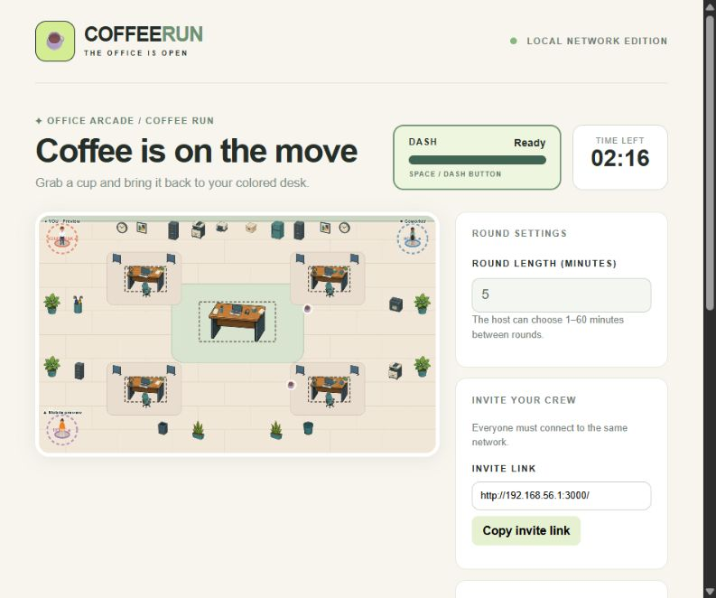
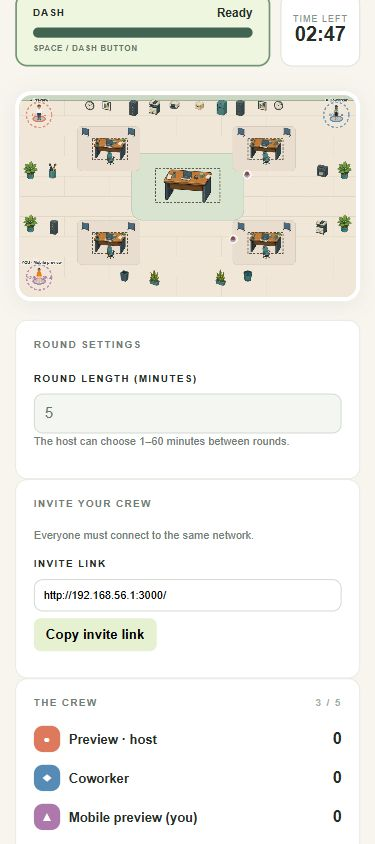

# ☕ Coffee Run

**Grab coffee. Cause chaos.**

Coffee Run is a 2–5 player browser game for coffee breaks and friendly rivalries. Race around the office, collect cups, and bring them back to your desk before your coworkers do. One person hosts; everyone else joins from a phone or laptop.



## The game plan

- **Collect and deliver:** Walk over a cup and bring it to your matching colored desk. Golden Coffee is worth three points.
- **Dash and disrupt:** Dash into a rival to knock their cup loose, then grab it for yourself.
- **Play a championship:** Compete across three rounds, with changing layouts, events and power-ups. The host can set rounds from 1 to 60 minutes.
- **Bring the whole crew:** Play on a local network or share a Cloudflare quick-tunnel link. No player accounts are required.

## Start a game

The host needs [Node.js 18 or newer](https://nodejs.org/). From the project folder, run:

```bash
npm install
npm start
```

1. Open [localhost:3000](http://localhost:3000) on the host computer.
2. Share the printed Cloudflare invite link for internet play, or the printed local network address for players on the same network. The public link changes each time the server restarts.
3. Everyone enters a name. The first player to join is the host. At least two connected players must ready up before the host starts the countdown.
4. Keep the server running while playing; stop it with `Ctrl+C` when finished.

The included quick-tunnel executable is for Windows. On other systems, local-network play is available; set `COFFEE_NO_TUNNEL=1` to skip starting the bundled executable.

If local players cannot connect, check that devices are on the same non-guest network and that the host's private-network firewall allows Node.js. Some office networks isolate devices. If port 3000 is in use, set `PORT` before starting (PowerShell: `$env:PORT=3001; npm start`).

## Controls

| | Move | Dash |
| --- | --- | --- |
| Keyboard | WASD or arrow keys | Space |
| Touchscreen | On-screen joystick | DASH button |

Carrying coffee slows you down. Cup Lids block a hit, Sneakers give a temporary speed boost, and round events change the pace. Sound and reduced-motion controls are available beside the board.

## Play on the go

The layout adapts to smaller screens, so players can join from a phone as well as a computer.



*Screenshots show a gameplay preview; the interface may differ slightly from the current version.*

## Connection details

The host simulates movement and sends updates 20 times per second. Players can join an active round if a slot is free, starting with zero points. If a player disconnects, their cup is dropped and the game attempts to restore their slot and score for 30 seconds. If the host does not return within that period, host privileges pass to another player. Network latency and Wi-Fi quality can affect play.

## Artwork credits

The office scene incorporates [Modern Office 2D Top-Down Props Pack](https://nacl1234.itch.io/top-down-modern-office-2d-asset-pack), and the characters use free samples of [Modern Citizens](https://nacl1234.itch.io/modern-citizens-top-down-animated-characters), both by nacl1234. These are free, AI-assisted assets whose licenses permit use in games while restricting redistribution of the original assets. The office scene and character atlas are integrated into the game; do not redistribute the original asset packs as separate files.
